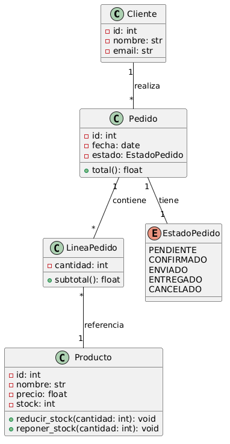
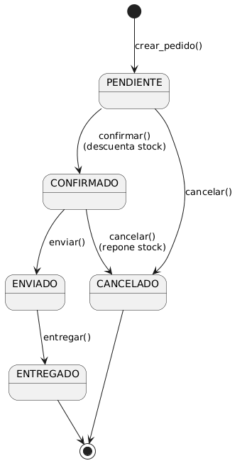

# Sistema de Ventas

Proyecto de ejemplo usado en el taller de RAG Agéntico. Es un sistema de ventas
en capas: un cliente crea pedidos con productos, el pedido transita por un ciclo
de vida (pendiente → confirmado → enviado → entregado) y puede persistirse en JSON.

## Estructura por capas

- `dominio/` — entidades (`Cliente`, `Producto`, `LineaPedido`, `Pedido`) y estados.
- `servicios/` — lógica de negocio (`ServicioVentas`): stock, descuentos, transiciones.
- `persistencia/` — guardar y cargar pedidos en JSON.
- `api/` — capa de entrada (CLI de ejemplo).
- `modelo/` — diagramas UML (clases y máquina de estados) en PlantUML.
- `tests/` — pruebas automatizadas.

## Cómo se relaciona con el taller

El asistente de IA indexa este proyecto y responde preguntas sobre el código,
la documentación, el UML y las pruebas, citando el archivo de donde proviene
cada respuesta.

## Qué hace el sistema

Un pedido transita por una máquina de estados. Así se ve la salida de ejemplo:

```
[1] Pedido #1 creado   → estado 'pendiente' · total $360.00
[2] confirmar()        → estado 'confirmado' · stock descontado
[3] enviar()           → estado 'enviado'
[4] entregar()         → estado 'entregado'
[5] total $360.00      → con descuento (10 %): $324.00
[6] Pedido #2: crear → confirmar → cancelar → stock repuesto
```

### Diagramas UML




